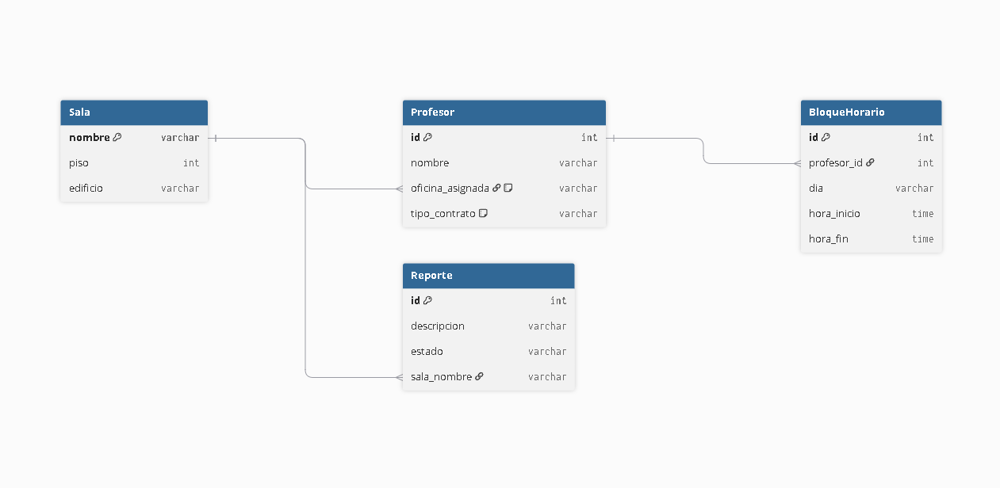

# 2026-2-CC4401-grupo-6

Para mantener el orden y no volvernos locos buscando las cosas, esta es la estructura basica.

*   **`README.md`**: Es este mismo documento. Es la portada de nuestro proyecto, donde anotamos de qué trata, qué tareas estamos haciendo y cómo instalarlo.
*   **`.gitignore`**: Es un archivo invisible para nosotros, pero vital para Git. Su trabajo es bloquear y evitar que subamos "archivos basura" (como la base de datos local o archivos temporales de nuestros computadores). **No lo borren.**
*   **`requirements.txt`**: Es simplemente una lista de compras. Aquí anotamos las herramientas que usa el proyecto (por ejemplo, "Django"). Así, si alguien nuevo entra, instala todo de un golpe leyendo este archivo.

**Carpeta de Datos (`/data`)**
Aquí va todo lo relacionado con la información que estamos recopilando de la universidad antes de meterla a la base de datos web.
*   **`data/raw/`**: Significa "datos crudos". Aquí guardamos los archivos originales tal cual los creamos o descargamos (los Excel, CSV o JSON con las listas de salas y profesores). 
*   **`data/scripts/`**: Aquí guardaremos los pequeños códigos o scripts que hagamos para limpiar, arreglar o filtrar los datos de la carpeta "raw".

Diagrama propenso a cambios.

BloqueHorario ➔ Profesor: La flecha indica que un profesor posee múltiples bloques de horario en la semana.

Reporte ➔ Sala: La flecha indica que una misma sala puede recibir múltiples reportes.

Profesor ➔ Sala: La flecha indica que muchos profesores pueden compartir una sola sala u oficina (Esto porque creo que hay salas que pueden tener mas de 1 profesor asi como
la sala de informacion que hay 3 personas, pero de lo anterior no estoy tan seguro). 

oficina_asignada: Puede no tener oficina asignada.

profesor_id y sala_nombre son Foreign Key

tipo_contrato: Completa, parcial y externo (esto porque en la pagina del dcc los separa asi a los profesores)

