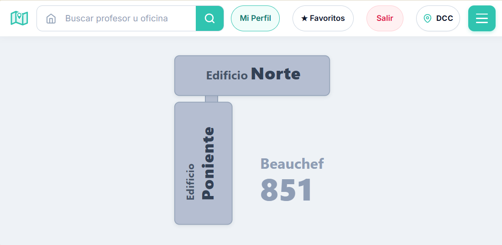
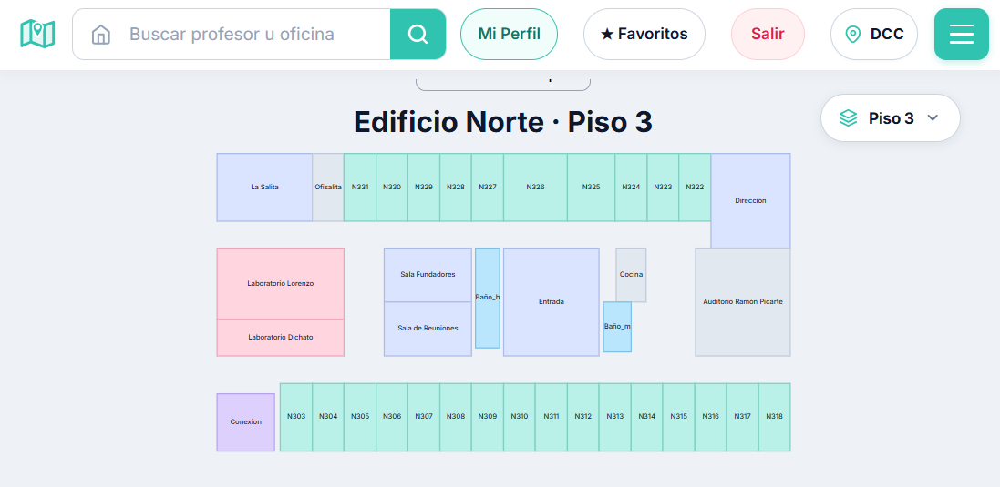
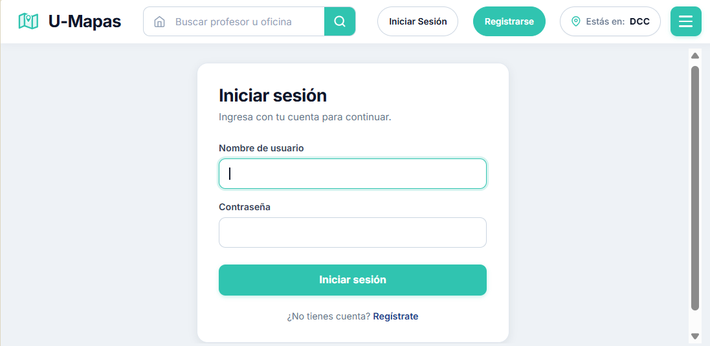
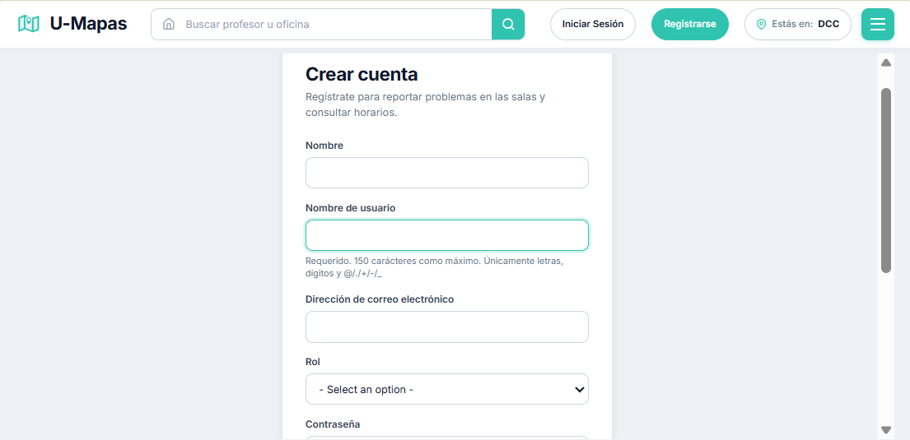

<p align="center">
  
  
  
  
</p>

<h1 align="center">U-Mapas</h1>
<h3 align="center">Interactive Indoor Map for the DCC — Beauchef 851</h3>

<p align="center">
  Navigate the Department of Computer Science (DCC&nbsp;— FCFM, Universidad de Chile) with an interactive SVG-based map.<br/>
  Look up professor offices, check office-hour schedules, bookmark your favorite rooms, and get <strong>shortest-path directions</strong> between any two spaces — all in your browser.
</p>

---

## Features

| Feature | Description |
|:--------|:------------|
| **Campus Overview** | Bird's-eye schematic of the Norte and Poniente buildings with one-click drill-down. |
| **Floor Viewer** | Detailed SVG floor plans — click any room to see its type, assigned professors, and office hours. |
| **Shortest Path** | Dijkstra-powered routing between any two rooms on the same floor via NetworkX. |
| **Favorites** | Bookmark rooms and professors for quick access from a personal dashboard. |
| **Auth System** | Register / Log in / Log out with role-based accounts (Professor, Student, Staff). |
| **Community Reports** | Submit and confirm issue reports linked to specific rooms. |

---

## Screenshots

<!-- 
  To add screenshots: run the app, take screenshots of each view, 
  and save them in the docs/ folder with these names:
  - screenshot_campus.png   (main campus overview)
  - screenshot_floor.png    (floor plan viewer)
  - screenshot_login.png    (login page)
  - screenshot_register.png (register page)
-->

<table>
  <tr>
    <td align="center" width="50%">
      <strong>Campus Overview</strong><br/>
      
    </td>
    <td align="center" width="50%">
      <strong>Floor Plan Viewer</strong><br/>
      
    </td>
  </tr>
  <tr>
    <td align="center" width="50%">
      <strong>Login</strong><br/>
      
    </td>
    <td align="center" width="50%">
      <strong>Register</strong><br/>
      
    </td>
  </tr>
</table>

---

## Tech Stack

| Layer | Technology |
|:------|:-----------|
| Backend | Django 6.1 (views, ORM, auth) |
| Routing Engine | NetworkX 3.7 — Dijkstra shortest-path |
| Frontend | Vanilla JS + SVG floor plans, Inter font |
| Data Seeds | CSV files loaded via custom management command |
| Database | SQLite (dev) |

---

## Quick Start

```bash
# 1. Clone & enter
git clone https://github.com/<your-org>/2026-2-CC4401-grupo-6.git
cd 2026-2-CC4401-grupo-6

# 2. Virtual environment
python -m venv venv
# Windows
.\venv\Scripts\activate
# macOS / Linux
source venv/bin/activate

# 3. Install dependencies
pip install -r requirements.txt

# 4. Migrate & seed data
python manage.py migrate
python manage.py poblar_datos   # loads rooms, professors & navigation graph

# 5. Run
python manage.py runserver
```

Open **http://127.0.0.1:8000/** and start exploring!

> **Optional:** create a superuser for the Django admin panel:
> ```bash
> python manage.py createsuperuser
> ```

---

## Project Structure

```
├── manage.py
├── requirements.txt
├── config/              # Django project settings
├── core/                # Main application
│   ├── models.py        # User, Piso, Sala, Profesor, BloqueHorario, Reporte, Nodo, Arista, LugarFavorito
│   ├── forms.py         # Auth & registration forms
│   ├── services/        # Business logic (graph construction, Dijkstra routing)
│   ├── views/           # Controllers by domain (mapa, auth, favoritos)
│   ├── management/      # poblar_datos management command
│   ├── urls.py          # URL routing
│   └── tests.py         # Automated test suite
├── frontend/
│   ├── templates/       # Django templates (base, index, login, register, favoritos…)
│   └── static/          # CSS & JS assets
├── data/                # CSV seed files (rooms, professors, graph nodes & edges)
└── docs/                # Documentation & diagrams
```

---

## API Reference

### Web Views

| Method | Route | Description |
|:-------|:------|:------------|
| `GET` | `/` | Interactive campus map & floor viewer |
| `GET/POST` | `/login` | User login |
| `GET/POST` | `/register` | Account registration (Professor / Student / Staff) |
| `GET` | `/logout` | Log out |
| `GET` | `/favoritos/` | Personal favorites dashboard (auth required) |
| `GET` | `/admin/` | Django admin panel |

### JSON Endpoints

| Method | Endpoint | Description |
|:-------|:---------|:------------|
| `GET` | `/api/pisos/<building>/` | Available floor numbers for a building |
| `GET` | `/api/piso/<building>/<floor>/` | Floor dimensions, rooms (geometry), and assigned professors |
| `GET` | `/api/ruta/<building>/<floor>/<from>/<to>/` | Shortest path between two rooms (Dijkstra) |
| `GET` | `/api/ruta-nodos/<building>/<floor>/<from>/<to>/` | Shortest path between two graph nodes |
| `POST` | `/api/favoritos/toggle/<room_id>/` | Add / remove a room from favorites |
| `GET` | `/api/favoritos/estado/<room_id>/` | Check if a room is bookmarked |

---

## Data Model

<p align="center">
  
</p>

| Entity | Purpose |
|:-------|:--------|
| **User** | Extends `AbstractUser` — adds `nombre` and institutional `rol` (Professor / Student / Staff) |
| **Piso** | Building floor: `edificio` + `numero` with SVG canvas dimensions |
| **Sala** | Physical room on a floor (room, office, lab, bathroom, stairs, other) with SVG coordinates |
| **Profesor** / **BloqueHorario** | Faculty member linked to an office, with weekly office-hour blocks |
| **Reporte** | Community-submitted issue report attached to a room |
| **Nodo** / **Arista** | Navigation graph used for Dijkstra shortest-path routing |
| **LugarFavorito** | User ↔ Room bookmark relation |

---

## Running Tests

```bash
python manage.py test
```

---

## Team

Built for **CC4401 — Software Engineering** (2026-2) at the University of Chile.

---

<p align="center">
  Made with ❤️ at Beauchef 851
</p>
