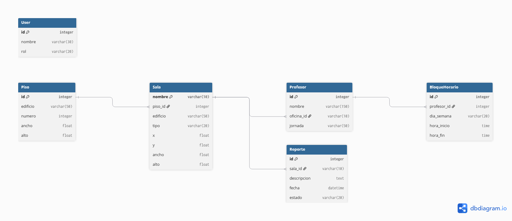

# U-Mapas — Mapa Interactivo DCC (Beauchef 851)

Aplicación web interactiva para orientarse dentro del Departamento de Ciencias de la Computación (DCC — FCFM, Universidad de Chile), consultar oficinas y horarios de atención docente, y calcular rutas óptimas entre espacios.

---

## Estructura del Proyecto

```text
├── manage.py               # CLI de administración de Django
├── requirements.txt        # Dependencias de Python (Django, NetworkX)
├── config/                 # Configuración global del proyecto Django
├── core/                   # Backend (Modelos, Servicios, Vistas/API, Comandos, Tests)
│   ├── models.py           # Modelos relacionales (Piso, Sala, Profesor, BloqueHorario, Reporte, Nodo, Arista)
│   ├── services/           # Lógica de negocio (construcción de grafos y algoritmo Dijkstra en rutas.py)
│   ├── views/              # Controladores HTTP y endpoints JSON (/api/...)
│   ├── management/         # Comando maestro poblar_datos
│   └── urls.py             # Rutas de la aplicación
├── frontend/               # Frontend (Plantillas HTML y archivos estáticos CSS/JS)
│   ├── templates/          # base.html, index.html y componentes en partials/
│   └── static/             # Hojas de estilo (css/) y módulos de cliente (js/api.js, js/map.js)
├── data/                   # Semillas de datos limpias en formato CSV
│   ├── salas.csv           # Salas y su geometría SVG (x, y, ancho, alto)
│   ├── profesores.csv      # Nómina docente y oficina asignada
│   ├── nodos.csv           # Nodos del grafo de navegación (puertas y pasillos)
│   └── aristas.csv         # Conexiones entre nodos
└── docs/                   # Documentación y diagramas del proyecto
    └── diagrama_modelo_datos.png
```

---

## Cómo iniciar el proyecto localmente

1. **Crear y activar el entorno virtual (`venv`):**
   * Crear: `python -m venv venv`
   * Activar (Mac/Linux): `source venv/bin/activate`
   * Activar (Windows): `.\venv\Scripts\activate`
2. **Instalar dependencias:**
   ```bash
   pip install -r requirements.txt
   ```
3. **Aplicar migraciones de base de datos:**
   ```bash
   python manage.py migrate
   ```
4. **Poblar la base de datos (salas, geometría, profesores y grafo de rutas):**
   ```bash
   python manage.py poblar_datos
   ```
5. **(Opcional) Crear usuario administrador:**
   ```bash
   python manage.py createsuperuser
   ```
6. **Levantar el servidor de desarrollo:**
   ```bash
   python manage.py runserver
   ```
   * Mapa interactivo: `http://127.0.0.1:8000/`
   * Panel de administración: `http://127.0.0.1:8000/admin/`

---

## Modelo de Datos



* **`Piso`**: Nivel de un edificio (`edificio` + `numero`) y dimensiones de su lienzo SVG (`ancho`, `alto`).
* **`Sala`**: Espacio físico dentro de un piso (`sala`, `oficina`, `lab`, `bano`, `escalera`, `otro`), con coordenadas (`x`, `y`, `ancho`, `alto`) y vínculo a su `Nodo` puerta.
* **`Profesor`** y **`BloqueHorario`**: Docentes asociados a su oficina (`Sala`) y bloques de atención semanal.
* **`Reporte`**: Reportes comunitarios de problemas o estado asociados a una `Sala`.
* **`Nodo`** y **`Arista`**: Grafo geométrico de navegación utilizado para calcular el camino más corto mediante Dijkstra (`networkx`).
